# Graphify — Aanur Textile Knowledge Graph & Architecture Skill

This skill provides **automated codebase visualization, AST dependency extraction, graph-guided navigation, and architecture modeling** specifically for the **Aanur Textile** project (MERN Stack: React 19, Express, MongoDB Atlas, Node.js, and Resend).

The project graph is maintained in `graphify-out/` and tracks symbols, dependencies, and execution paths spanning the React frontend, Express server middleware, MongoDB Atlas database, and Resend email pipelines.

---

## Aanur Textile Project Architecture Map

```mermaid
graph TB
    subgraph Client["🖥️ Frontend Client (React 19 + Vite + GSAP)"]
        direction TB
        App["App.jsx - Root Router & State"]
        Catalog["Catalog & ProductGrid - Product Listings"]
        BestOffers["BestOffersPage - 5 Best Offers & Secret Coupons"]
        Detail["ProductDetail & QuickView - Modal & Product Views"]
        Cart["CartPage & Checkout - Cart & Order Processing"]
        Anim["GSAP 3 + ScrollTrigger - Textile Animations"]
        DataFallback["src/data.js - Local Mock & Fallback Data"]
    end

    subgraph Middleware["⚙️ Server Middleware (Express on Vite connect)"]
        direction TB
        ExpressPlugin["vite.config.js - expressPlugin()"]
        AppServer["server/app.js - Express App"]
        ApiHandler["server/api.js - handleApiRequest()"]
        StatusRoute["GET /api/status - Health & DB Diagnostics"]
        ProductsRoute["GET /api/products - Catalog Service"]
        OrdersRoute["POST /api/orders - Order Processing Service"]
        EnquiriesRoute["POST /api/enquiries - Contact Inquiry Service"]
    end

    subgraph DataLayer["🍃 Database (MongoDB Atlas + Mongoose)"]
        direction TB
        MongoClient["server/db.js - connectMongoDB()"]
        ProductModel["Product Model - Mongoose Schema"]
        OrderModel["Order Model - Mongoose Schema"]
        EnquiryModel["Enquiry Model - Mongoose Schema"]
    end

    subgraph EmailLayer["✉️ Email & Notifications (Resend API)"]
        direction TB
        EmailService["server/email.js - sendOrderEmail()"]
        ResendClient["Resend SDK - Order Confirmation HTML"]
    end

    subgraph MCPSystem["🤖 Resend MCP Subsystem"]
        direction TB
        McpServer["resend-mcp/ - Model Context Protocol server"]
        McpTools["Email, Domain, Log & Topic Tools"]
    end

    App --> Catalog
    App --> BestOffers
    App --> Detail
    App --> Cart
    App -.->|"Offline Fallback"| DataFallback
    App -->|"HTTP Fetch"| ApiHandler
    
    ExpressPlugin --> AppServer
    AppServer --> ApiHandler
    ApiHandler --> StatusRoute
    ApiHandler --> ProductsRoute
    ApiHandler --> OrdersRoute
    ApiHandler --> EnquiriesRoute

    ProductsRoute -->|"find()"| ProductModel
    OrdersRoute -->|"create()"| OrderModel
    OrdersRoute -->|"Trigger"| EmailService
    EnquiriesRoute -->|"create()"| EnquiryModel

    ProductModel --- MongoClient
    OrderModel --- MongoClient
    EnquiryModel --- MongoClient

    EmailService --> ResendClient
    MCPSystem -.->|"Agentic Tooling"| ResendClient

    style Client fill:#0d1117,stroke:#58a6ff,color:#c9d1d9
    style Middleware fill:#0d1117,stroke:#3fb950,color:#c9d1d9
    style DataLayer fill:#0d1117,stroke:#10b981,color:#c9d1d9
    style EmailLayer fill:#0d1117,stroke:#f97316,color:#c9d1d9
    style MCPSystem fill:#0d1117,stroke:#a855f7,color:#c9d1d9
```



---

## Knowledge Graph Artifacts

All graph data is compiled into `graphify-out/`:

| Artifact | Location | Purpose |
|---|---|---|
| **2D Interactive Graph** | [`graphify-out/graph.html`](file:///X:/New%20folder%20(2)/graphify-out/graph.html) | Interactive physics-based visualization of all code nodes, communities, and links |
| **Hierarchical D3 Tree** | [`graphify-out/GRAPH_TREE.html`](file:///X:/New%20folder%20(2)/graphify-out/GRAPH_TREE.html) | Collapsible folder and symbol hierarchy tree |
| **Knowledge Graph Database** | [`graphify-out/graph.json`](file:///X:/New%20folder%20(2)/graphify-out/graph.json) | Complete GraphRAG-ready node and edge topology |
| **Graph Audit Report** | [`graphify-out/GRAPH_REPORT.md`](file:///X:/New%20folder%20(2)/graphify-out/GRAPH_REPORT.md) | Community clusters, god nodes, and surprising inferences |

---

## Quick Workflows & Commands

### 1. Rebuilding & Updating the Knowledge Graph
Whenever code in `src/`, `server/`, or `scripts/` changes, update the graph:
```powershell
# Via Graphify CLI directly:
graphify update .
graphify tree

# Or via project helper script:
powershell .agents/skills/graphify/scripts/update-graph.ps1
```

### 2. Opening Visual Dashboards
```powershell
# Open interactive 2D graph in default browser:
powershell .agents/skills/graphify/scripts/open-graph.ps1 -View graph

# Open D3 collapsible hierarchy tree:
powershell .agents/skills/graphify/scripts/open-graph.ps1 -View tree
```

### 3. Querying Architecture with Graph Traversal
Instead of manual grep searches, query the graph directly:

```powershell
# Answer architectural questions with BFS:
graphify query "How does an order flow from Checkout to MongoDB Atlas and Resend email?"

# Find the shortest dependency path between any two symbols:
graphify path "Checkout" "sendOrderEmail"
graphify path "handleApiRequest" "Product"

# Explain a specific symbol and its neighbors:
graphify explain "handleApiRequest"
graphify explain "sendOrderEmail"
graphify explain "connectMongoDB"
```

---

## Curated Reports & Diagnostics

When the user asks for deep system inspections or architecture documentation:
- Consult [Architecture Reference](references/architecture.md) for endpoint and schema breakdown.
- Consult [Mermaid Style Guide](references/mermaid_styles.md) for standard dark-mode colors.
- Consult [Query Cookbook](references/query_cookbook.md) for high-value architecture queries.
- See [Full Architecture Report Example](examples/aanur_architecture_report.md) for report formats.
