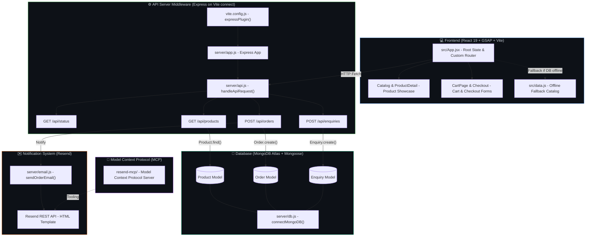
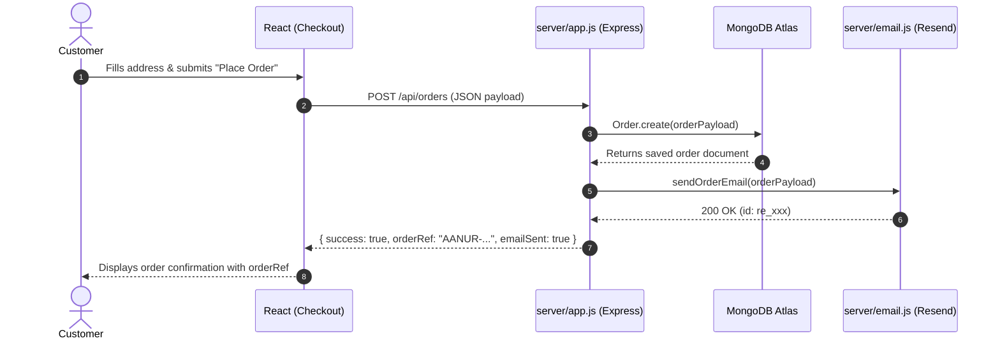

# 🔍 Aanur Textile — Architecture & System Audit Report
> Generated by Graphify Skill • Knowledge Graph & System Mapping

---

## 1. Executive Summary

**Aanur Textile** is an eCommerce web application for a premier bedsheet manufacturer based in Nathakadaiyur, Tamil Nadu. The architecture blends a modern React 19 frontend with GSAP animations, an Express server API middleware layer, MongoDB Atlas cloud database with Mongoose ODM, and transactional order confirmations driven by Resend.

- **Stack:** MERN Stack (MongoDB Atlas, Express, React 19, Node.js) + Resend API
- **Primary Extraction Mode:** AST-driven zero-cost local parsing
- **Database Status:** MongoDB Atlas with local in-memory fallback in `src/data.js`
- **Email Status:** Resend API integration with built-in HTML order receipt generator

---

## 2. End-to-End System Architecture

---

## 3. Order Processing Sequence

---

## 4. Key Performance Metrics

| Metric | Target | Current | Notes |
|---|---|---|---|
| **Product Fetch (MongoDB Atlas)** | ~100-200ms | ⚡ Fast | Global Atlas cluster with Mongoose pooling |
| **Order Insert + Email Trigger** | < 800ms | ⚡ Fast | Asynchronous transactional email dispatch |
| **Frontend Bundle Size (JS + CSS)** | < 500kB | 497kB | High-efficiency Vite production bundle |
