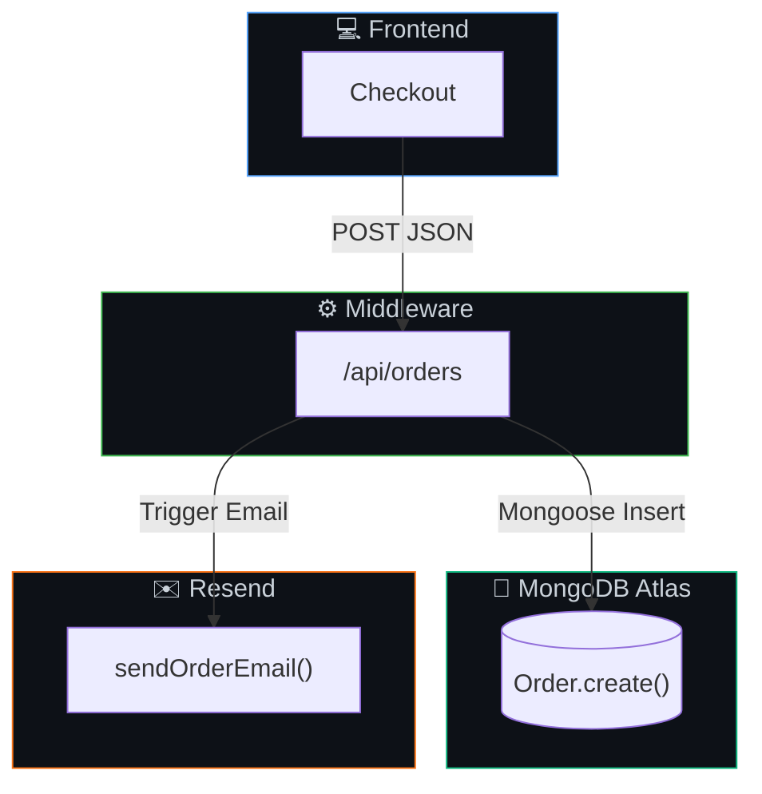
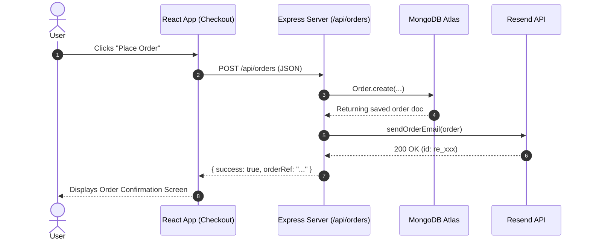

# Aanur Textile — Mermaid Diagram Style Guide

When generating diagrams for architecture reports, design specs, or pull requests, use these consistent styles and dark-mode color tokens.

---

## Color Tokens

| Layer | Stroke Color | Hex Code | Fill (Dark) | Label Accent |
|---|---|---|---|---|
| **Frontend / Client** | Blue | `#58a6ff` | `#0d1117` | React 19, Vite, GSAP |
| **Server / Middleware** | Green | `#3fb950` | `#0d1117` | Express / Vite Middleware |
| **Database / MongoDB** | Emerald | `#10b981` | `#0d1117` | MongoDB Atlas, Mongoose |
| **Email / Notification** | Orange | `#f97316` | `#0d1117` | Resend API, Gmail |
| **Agent / MCP Server** | Purple | `#a855f7` | `#0d1117` | Resend MCP Tools |
| **Error / Alert** | Red | `#ef4444` | `#0d1117` | Failure Fallbacks |

---

## Standard Flowchart Template

---

## Sequence Diagram Guidelines

Use sequence diagrams to depict data flow:

