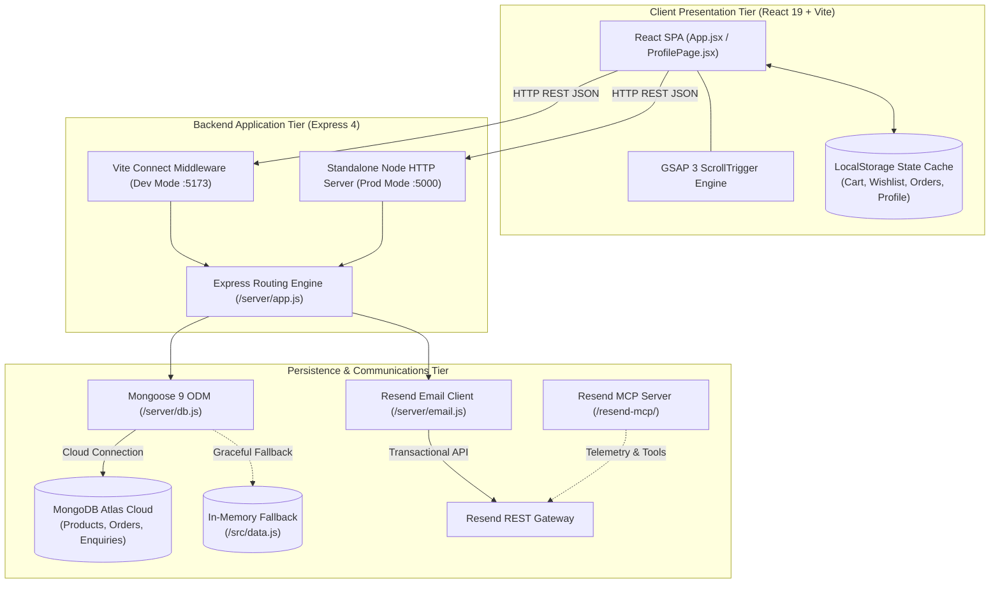

# 🧵 Aanur Textile — Enterprise Full-Stack Textile & Fabric Commerce Platform

[](https://react.dev/)
[](https://vitejs.dev/)
[](https://expressjs.com/)
[](https://www.mongodb.com/)
[](https://resend.com/)
[](https://greensock.com/gsap/)
[](https://modelcontextprotocol.io/)
[](LICENSE)

> **Official Repository:** [https://github.com/Phoenix05420/Aanur-textile](https://github.com/Phoenix05420/Aanur-textile)  
> **Brand Vision:** *"Comfort, Considered."* — Handcrafted bedsheets and master-woven textiles shipped factory-direct from Nathakadaiyur, Kangayam, Tiruppur — Tamil Nadu's historic textile capital.

---

## 📑 Table of Contents

- [🎯 Project Overview & Value Proposition](#-project-overview--value-proposition)
- [🚀 Key Features](#-key-features)
- [🛠️ Tech Stack & Architecture](#️-tech-stack--architecture)
- [⚙️ Installation & Local Setup](#️-installation--local-setup)
- [🗺️ API Architecture & Endpoints](#️-api-architecture--endpoints)
- [🤝 Contributing & License](#-contributing--license)

---

## 🎯 Project Overview & Value Proposition

### The Context
The South Indian textile corridor spanning **Tiruppur, Kangayam, and Nathakadaiyur** produces some of the world's finest combed cotton, yarn-dyed checks, and woven home textiles. However, traditional textile commerce is bottlenecked by fragmented broker networks, multi-tiered markups, and delayed communication channels between master weavers and modern buyers.

### What is Aanur Textile?
Founded in **2013 by Velusamy R**, **Aanur Textile** has grown over 13+ years with a dedicated collective of 20+ master artisans. The **Aanur Textile Digital Commerce Platform** bridges this heritage manufacturing ecosystem directly with retail customers and institutional buyers through a high-performance, full-stack web application.

### Who It Serves
* **Direct-to-Consumer (B2C) Retail:** End consumers seeking export-grade 100% pure cotton bedsheets, heritage plaids, gingham checks, and soft home comforts shipped factory-direct to their doorstep anywhere in India within 7 to 14 days.
* **Business-to-Business (B2B) & Bulk Sourcing:** Boutique hotels, interior decorators, institutional procurers, and regional fabric stockists needing dependable wholesale quotes, customized weaving specifications, and verified loom traceability.

### Core Problems Solved
1. **Disintermediation of Middlemen:** By cutting out agent commissions and distributor markups, buyers receive authentic artisan weaves at fair factory pricing while artisans receive equitable value.
2. **Fabric Traceability & Transparency:** Eliminates ambiguous synthetic blend labeling through explicit material provenance (e.g., *100% Combed Cotton Weave*, *Cotton Rich Weave*, *Breathable Combed Cotton*).
3. **Zero-Latency Unified Runtime:** Bridges developer ergonomics and production resilience through a dual-mode Express engine that runs as embedded Vite dev middleware during development and as a standalone clustered HTTP service in production.
4. **Resilient Data Guarantees with Zero-Config Fallbacks:** Maintains operational continuity via seamless fallback to local in-memory catalog data when cloud database credentials are unconfigured or temporarily unreachable.

---

## 🚀 Key Features

### 🔐 User Authentication & Account Management
* **Dual-Mode OTP & Credentials Flow:** Authenticates users via mobile number or email credentials with session state cached in secure browser storage.
* **Unified Profile Dashboard (`ProfilePage.jsx`):** Provides a central hub for personal account metadata, customizable user avatars, and communication preferences.
* **Multi-Address Book:** Enables users to save, edit, and designate primary default addresses across Home, Studio, and Corporate shipping locations.
* **Loom & Fabric Preference Engine:** Allows shoppers to register preferred bed sizes (`Queen`, `King`, `Double`), favorite weave textures, and opt into WhatsApp loom drop alerts.

### 🧵 Catalog & Fabric Variant Filtering
* **Dynamic Variant Switching:** Automatically re-renders high-resolution product photography upon selecting distinct dye swatches (*Midnight Navy, Cocoa Brown, Rustic Crimson, Forest Olive, Mustard Ochre*).
* **Multi-Dimensional Parametric Filtering:** Filters collections across weave classifications, bed configurations (Single, Double, Queen, King), and price intervals.
* **Sub-Millisecond Search Execution:** Implements fuzzy keyword matching across product titles, weave descriptors, and color profiles with highlighted zero-state suggestions.
* **Artisan Quick View Modal:** Displays fabric specifications, thread count equivalents, dimensions, and instant cart additions without breaking catalog scroll position.

### 🛒 Shopping Bag & Dynamic Coupon Engine
* **Persistent Bag State:** Serializes cart line items, selected colorway indexes, and dimensional sizes across browsing sessions via browser `localStorage`.
* **Algorithmic Secret Coupon Validation:** Evaluates promotional codes in real-time, supporting flat deductions (`OFFER50`) and tiered percentage drops (`BESTOFFER`, `SECRET15`, `AANUR10`).
* **Live Price Breakdown Calculator:** Recalculates subtotal, coupon savings, factory logistics, and gross totals dynamically with zero server roundtrips.

### 📦 Order Management & Logistics Pipeline
* **Multi-Step Checkout Funnel:** Gathers recipient logistics, validates Indian PIN codes, and provides options for Cash on Delivery (COD) or Pre-paid transactions.
* **Collision-Resistant Order Identifiers:** Issues cryptographically randomized reference tags (`AT-XXXXXX`) indexable within MongoDB Atlas.
* **Nationwide Doorstep Delivery Promise:** Enforces standard 7-to-14-day delivery SLAs with clear milestone status badges (*Processing*, *Dispatched*, *Delivered*).
* **Order Tracking & Archival:** Archives completed purchases under the customer's profile with one-click re-ordering and invoice retrieval capabilities.

### 📨 Transactional Notifications & Communication
* **Dual-Recipient Resend Email Dispatch:** Automatically compiles responsive HTML receipts dispatched simultaneously to the buyer and the store administrative inbox.
* **Branded Clean HTML Templates:** Renders responsive email layouts displaying itemized tables, variant thumbnails, pricing summaries, and direct factory contact details.
* **Wholesale & Enquiry Intake Pipeline:** Routes custom bulk fabric inquiries directly to backend MongoDB collections and store operators.

### ⚙️ Administrative Dashboard & Architecture Telemetry
* **Cluster Health Diagnostics (`/api/status`):** Exposes live MongoDB connection readiness, host cluster topology, and record counts for products, orders, and inquiries.
* **Catalog Seeding & Synchronization:** Provides automated idempotent migration scripts to initialize and update cloud collections from structured data definitions.
* **Hardware-Accelerated GSAP Animations:** Employs GSAP 3 and ScrollTrigger for buttery-smooth layout reveals, sticky glassmorphic nav transitions, and tactile hover physics.

### 🤖 AI-Ready Tooling & Architecture Graph
* **Embedded Model Context Protocol (`resend-mcp/`):** Bundles a dedicated MCP server enabling autonomous AI coding agents to inspect Resend logs, query domains, and manage transactional infrastructure.
* **Living Code Knowledge Graph (`graphify`):** Maps AST dependencies, module god nodes, and community structures across the entire repository with zero API cost.

---

## 🛠️ Tech Stack & Architecture

### System Architecture Diagram



### Comprehensive Stack Specification

| Category | Technology | Version | Justification & Architectural Role |
| :--- | :--- | :--- | :--- |
| **Frontend Framework** | [React](https://react.dev/) | `^19.1.0` | Powers the reactive Single-Page Application using modern hooks, suspense-ready lifecycles, and component tree isolation. |
| **Build & Dev Tool** | [Vite](https://vitejs.dev/) | `^6.3.5` | Delivers sub-second Hot Module Replacement (HMR) and roll-up production bundling with native ESM support. |
| **Motion & Micro-interactions** | [GSAP](https://greensock.com/gsap/) & `@gsap/react` | `^3.14.1` | Delivers high-performance, GPU-accelerated scroll reveals, sticky navbar state changes, and parallax storytelling. |
| **Backend Runtime** | [Node.js](https://nodejs.org/) & [Express](https://expressjs.com/) | `^4.21.2` | Minimalist HTTP server powering the REST API, unified dev middleware, and static production SPA fallback serving. |
| **Database & ODM** | [MongoDB Atlas](https://www.mongodb.com/) & [Mongoose](https://mongoosejs.com/) | `^9.11.2` | Schematized document database enforcing strict validation for polymorphic product variants, orders, and customer leads. |
| **Transactional Email** | [Resend](https://resend.com/) | `^6.32.1` | Modern developer-first email platform ensuring 99.9% inbox deliverability for order receipts and dispatch tracking. |
| **Agentic AI Tooling** | [Model Context Protocol (MCP)](https://modelcontextprotocol.io/) | `^2.25.0` | Embedded MCP server (`resend-mcp`) enabling LLMs and agents to query domains, webhooks, broadcasts, and email logs. |
| **Knowledge Graph** | [Graphify](https://github.com) | CLI / AST | Indexes code relationship graphs and architectural god nodes into interactive visual reports (`graphify-out/`). |
| **HTTP Client** | [Axios](https://axios-http.com/) | `^1.20.0` | Promise-based asynchronous HTTP client used across diagnostic scripts and client communications. |
| **Environment Management** | [dotenv](https://github.com/motdotla/dotenv) | `^18.0.7` | Injects runtime secrets and service tokens from isolated local `.env` files safely into Node environment variables. |

---

## ⚙️ Installation & Local Setup

Follow these sequential steps to clone, configure, seed, and launch the platform on your development workstation.

### Step 1: Verify Prerequisites
Ensure your local environment meets the minimum version requirements:
* **Node.js**: `v18.0.0` or higher (Node `v22+` recommended)
* **npm**: `v9.0.0` or higher
* **Git**: `v2.30.0` or higher
* **MongoDB Atlas URI** (optional, fallback data enabled by default)
* **Resend API Key** (optional, email logging enabled by default)

Check your installed versions:
```bash
node -v
npm -v
git --version
```

---

### Step 2: Clone Repository & Enter Directory
```bash
git clone https://github.com/Phoenix05420/Aanur-textile.git
cd Aanur-textile
```

---

### Step 3: Install Node Dependencies
Install all root application dependencies:
```bash
npm install
```
*(Optional)* If you plan to run or test the embedded MCP server:
```bash
cd resend-mcp && npm install && npm run build && cd ..
```

---

### Step 4: Environment Variable Configuration
Copy the sample environment file to create your local `.env`:
```bash
cp .env.example .env
```

Open `.env` in your preferred editor and populate the following schema:

```ini
# ==============================================================================
# 1. MongoDB Atlas Database Configuration
# ==============================================================================
# Standard MongoDB connection string with cluster URL and target database
MONGODB_URI=mongodb+srv://<username>:<password>@cluster0.xxxxx.mongodb.net/aanur_textile?retryWrites=true&w=majority

# ==============================================================================
# 2. Resend Transactional Email Configuration
# ==============================================================================
# API key generated from https://resend.com/api-keys (begins with 're_')
RESEND_API_KEY=re_xxxxxxxxxxxxxxxxxxxxxxxxxx

# Verified Sender Identity (use Resend's free onboarding domain for sandbox testing)
RESEND_FROM_EMAIL=Aanur Textile <onboarding@resend.dev>

# Store Administrator Recipient Inbox (receives all order and enquiry copies)
STORE_ADMIN_EMAIL=your-admin-email@gmail.com
```

> 💡 **Graceful Fallback Notice:** If `.env` is omitted or left unconfigured, the application automatically enters **Local Fallback Mode**. The catalog will load seamlessly from `src/data.js` and orders will log gracefully to the server console.

---

### Step 5: Database Health Check & Seeding
Validate your database connection and populate the collection with the initial 11 artisan bedsheet collections:

```bash
# 1. Check MongoDB Atlas connection & collection status
npm run db:check

# 2. Seed product catalog & variant definitions
npm run db:seed

# 3. (Optional) Dispatch a test email via Resend to verify API credentials
npm run email:test
```

---

### Step 6: Launch the Development Server

#### Option A: Unified Vite Dev Server (Recommended)
Starts the Vite dev server with Hot Module Reloading and mounts the Express REST API directly as connect middleware:
```bash
npm run dev
```
Open **[http://localhost:5173](http://localhost:5173)** in your browser.

#### Option B: Standalone Production Server
To preview or deploy the compiled production build:
```bash
# Compile optimized React assets to /dist
npm run build

# Start production Express server
npm run server
```
The server will bind to port `5000` (or `process.env.PORT`) at **[http://localhost:5000](http://localhost:5000)**.

#### Option C: Windows One-Click Quick Launch
On Windows machines, simply double-click **`start.bat`**. The batch script will automatically verify Node.js, run `npm install` if dependencies are missing, perform `.env` diagnostics, and start the development server.

---

## 🗺️ API Architecture & Endpoints

The backend exposes a lightweight, robust JSON REST API mounted under the `/api` route namespace:

| Endpoint | Method | Auth Required | Description | Request Body Example | Success Response |
| :--- | :---: | :---: | :--- | :--- | :--- |
| **`/api/status`** | `GET` | No | Returns system diagnostics, MongoDB Atlas connectivity status, host name, and live collection document counts. | *None* | `{"configured": true, "stack": "MERN", "counts": {"products": 11, "orders": 4}}` |
| **`/api/products`** | `GET` | No | Retrieves full bedsheet catalog with colorway swatches, pricing, images, and material specifications. | *None* | `{"products": [...], "source": "mongodb"}` |
| **`/api/products/:id`** | `GET` | No | Retrieves a single product document by its unique string identifier (e.g. `p01`). | *None* | `{"product": {...}, "source": "mongodb"}` |
| **`/api/orders`** | `POST` | No | Creates a new order, stores customer & line items in MongoDB Atlas, and triggers dual Resend HTML confirmation emails. | `{"orderRef": "AT-102948", "firstName": "Priya", "email": "priya@example.com", "total": 599, "items": [...]}` | `{"success": true, "orderRef": "AT-102948", "savedToMongo": true, "emailSent": true}` |
| **`/api/enquiries`** | `POST` | No | Ingests wholesale fabric requests, customer feedback, and institutional quotation inquiries into MongoDB. | `{"name": "Rajesh", "email": "rajesh@hotel.com", "topic": "Bulk Order", "message": "Need 100 sets"}` | `{"success": true, "id": "6714...", "savedToMongo": true}` |

---

## 🤝 Contributing & License

### How to Contribute
We welcome code contributions, design refinements, documentation enhancements, and bug reports from the open-source community.

1. **Fork the Repository:** Navigate to [Phoenix05420/Aanur-textile](https://github.com/Phoenix05420/Aanur-textile) and click **Fork**.
2. **Clone your Fork:**
   ```bash
   git clone https://github.com/<your-username>/Aanur-textile.git
   cd Aanur-textile
   ```
3. **Create a Dedicated Branch:** Adhere to standardized branch naming conventions:
   * `feature/` for new capabilities (e.g., `feature/razorpay-payment-gateway`)
   * `fix/` for bug fixes (e.g., `fix/coupon-calculation-rounding`)
   * `docs/` for documentation updates (e.g., `docs/api-specification-refresh`)
   * `chore/` for tooling and dependency upgrades (e.g., `chore/vite-bump`)
   ```bash
   git checkout -b feature/order-tracking-enhancement
   ```
4. **Implement & Test:** Make your modifications, verify local functionality via `npm run dev`, and run health checks:
   ```bash
   npm run db:check
   npm run build
   ```
5. **Commit Your Code:** Write clear, conventional commit messages:
   ```bash
   git commit -m "feat(checkout): add automated postal code validation for Tamil Nadu districts"
   ```
6. **Push to Your Fork & Open PR:**
   ```bash
   git push origin feature/order-tracking-enhancement
   ```
   Open a Pull Request against the `main` branch with a descriptive summary of your changes.

---

### License

This project is licensed under the **MIT License** — see the [LICENSE](LICENSE) file for full details.

```text
MIT License

Copyright (c) 2026 Aanur Textile / Phoenix05420

Permission is hereby granted, free of charge, to any person obtaining a copy
of this software and associated documentation files (the "Software"), to deal
in the Software without restriction, including without limitation the rights
to use, copy, modify, merge, publish, distribute, sublicense, and/or sell
copies of the Software, and to permit persons to whom the Software is
furnished to do so, subject to the following conditions:

The above copyright notice and this permission notice shall be included in all
copies or substantial portions of the Software.
```

---

### 📍 Headquarters & Store Contact

* **Brand Enterprise:** Aanur Textile
* **Proprietor / Founder:** Velusamy R *(13+ Years Textile Mastery, Established 2013)*
* **Mill & Weaving Unit:** 1/367 Merkuthottam, Palayakottai, Nathakadaiyur, Kangayam, Tiruppur 638108, Tamil Nadu, India
* **Telephone Support:** [+91 4257 245000](tel:+914257245000)
* **Administrative Email:** [contact@aanurtextile.com](mailto:contact@aanurtextile.com)
* **Map Location:** [View on Google Maps](https://maps.app.goo.gl/hhfBisaJndVEUiuS8)
* **Operating Hours:** Monday – Saturday, 9:00 AM – 8:00 PM IST (Sunday Closed)

---

<p align="center">
  <b>Aanur Textile</b> • <i>Handcrafted with Pride in Tamil Nadu's Historic Textile Belt</i>
</p>
